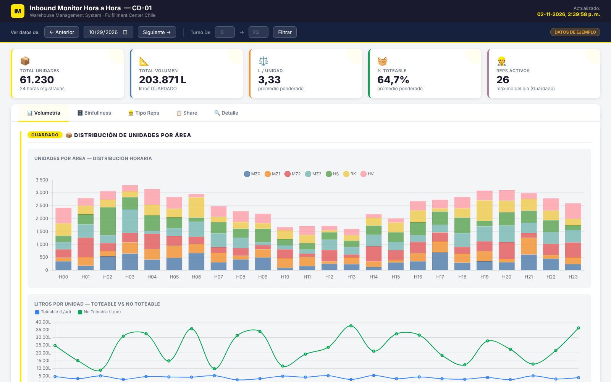
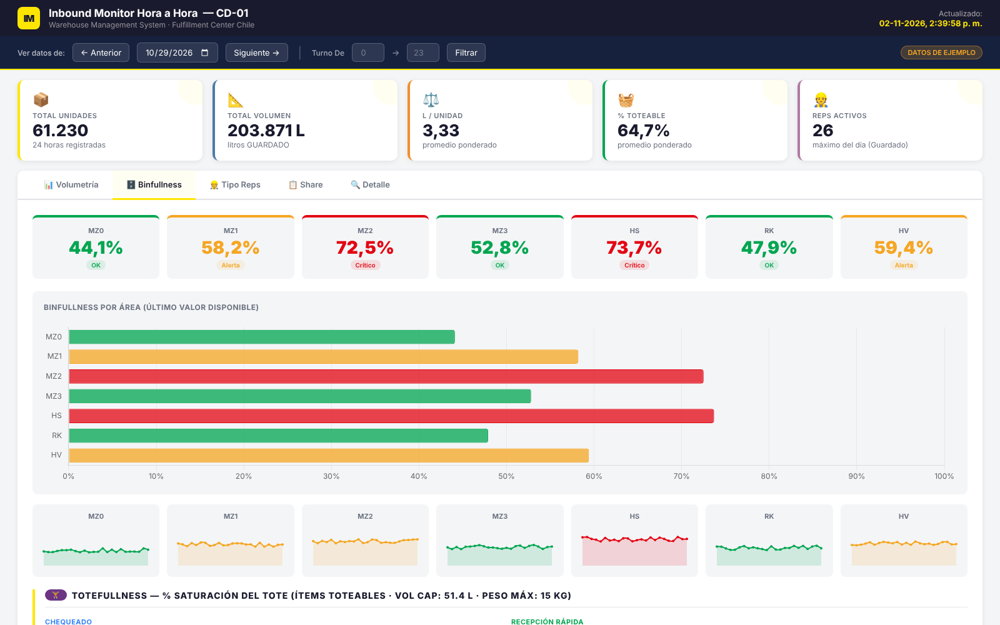
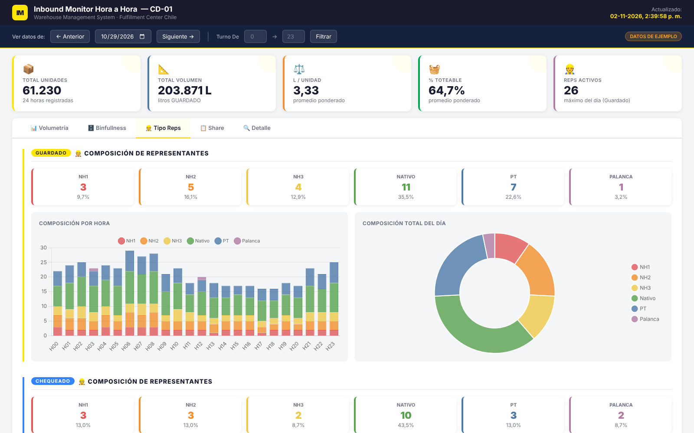
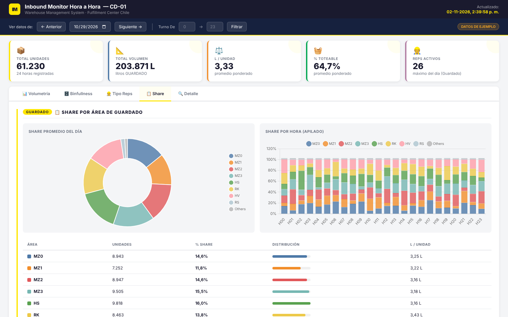

# PEAK SEASON — Monitor Inbound Hora a Hora

Tablero para seguir **hora a hora** la operación de entrada (inbound) de un centro de distribución durante temporada alta (peak): volumen, peso, unidades, totes, llenado de bins y la **composición del personal** por antigüedad, en sus tres procesos:

| Proceso | Qué es |
|---|---|
| **Guardado** | Ubicación del producto en su área de almacenamiento (mezanine, racks, estanterías, alta velocidad) |
| **Chequeado** | Recepción estándar: el producto se revisa y se carga en totes |
| **Recepción Rápida** | Recepción directa, sin pasar por el chequeo estándar |

Lo actualiza automáticamente cada hora un workflow **n8n** que calcula los indicadores en **BigQuery**.

> Versión **anonimizada**: los nombres de tablas, proyectos, hosts, centro de distribución y personas fueron reemplazados, y el demo usa **datos sintéticos**.



## Pestañas e indicadores

| Pestaña | Qué muestra |
|---|---|
| **Volumetría** | Unidades por área y hora, litros/unidad y kg/unidad (toteable vs no toteable), top 3 horas, unidades y totes por hora en Chequeado y Recepción Rápida |
| **Binfullness** | % de llenado de los bins por área (OK / Alerta / Crítico) con tendencia, y *Totefullness*: saturación del tote por volumen (cap. 51,4 L) y peso (máx. 15 kg) |
| **Tipo Reps** | Composición del personal por hora y en el día, para cada proceso |
| **Share** | Participación de cada área en el guardado, totes por tamaño (XS a XL) y totes por rango de peso |
| **Detalle** | Tabla hora a hora con todos los indicadores y totales |

KPIs arriba: total de unidades, volumen total (L), litros por unidad, % toteable y reps activos.

### Tipos de representantes (reps)

| Tipo | Significado |
|---|---|
| **NH1** | *New Hire*: está en su 1ª semana |
| **NH2** | 2ª semana |
| **NH3** | 3ª semana |
| **NATIVO** | 4 semanas o más: personal con curva de aprendizaje completa |
| **PT** | Part time |
| **PALANCA** | Apoyo externo (empresa de servicios) |

En peak, la proporción de NH vs Nativos explica gran parte de la variación de productividad hora a hora.

| Binfullness | Tipo Reps | Share |
|---|---|---|
|  |  |  |

## Arquitectura

```
 n8n Schedule (cada hora)
   ├─ BigQuery: 01_guardado_hora.sql          → tabla PUTAWAY_HORA
   ├─ BigQuery: 02_chequeado_hora.sql         → tabla CHECKIN_HORA
   ├─ BigQuery: 03_recepcion_rapida_hora.sql  → tabla DCI_HORA
   └─ BigQuery: 04_lecturas_dashboard.sql (3 lecturas)
          → Merge → Aggregate → API (upload-url → PUT → publish)
                                        ↓
                               dashboard/index.html
```

Detalles del cálculo:
- **Hora local con cambio de horario:** usa una función de zona horaria en vez de sumar un offset fijo.
- **Volumen por unidad:** usa el volumen del catálogo o, si falta, alto × largo × ancho.
- **Clasificación de reps:** semanas desde el primer día operativo de cada persona.
- **Saturación del tote:** el mayor entre % de volumen y % de peso.

## Estructura

```
dashboard/
  index.html        Dashboard (HTML + CSS + JS, sin build) — incluye generador de datos de ejemplo
  vendor/           Chart.js 4.4.7 (licencia MIT)
n8n/workflow.json   Workflow para importar en n8n
sql/                Las consultas de cada nodo
docs/img/           Capturas
```

## Cómo verlo

**Rápido:** abre `dashboard/index.html` en el navegador. Muestra datos de ejemplo de 3 días.

**Con datos reales:** deja el JSON que exporta el workflow (un arreglo de filas con la columna `PROCESO` = `PUTAWAY` / `CHECKIN` / `DCI`) en `dashboard/data/peak_data.json` y sirve la carpeta:

```bash
cd dashboard && python -m http.server 8000   # → http://localhost:8000
```

## Workflow n8n

1. **Workflows → Import from file** → `n8n/workflow.json`.
2. Reemplaza los marcadores:
   - `YOUR_GCP_PROJECT_ID` y las tablas `your-project.*`.
   - `YOUR_DASHBOARD_HOST` / `YOUR_DOCUMENT_ID`.
   - `REPLACE_WITH_YOUR_CREDENTIAL_ID`.
3. Crea 2 tablas de configuración:
   - `config.SUPERVISORES (LDAP_USER, TURNO)`: asigna el turno de cada rep según su supervisor.
   - `config.USUARIOS_EXCLUIDOS (LDAP_USER)`: usuarios que no se cuentan como reps.

## Tecnologías

HTML · CSS · JavaScript · Chart.js · n8n · Google BigQuery (SQL)

## Autor

Julio Novoa
